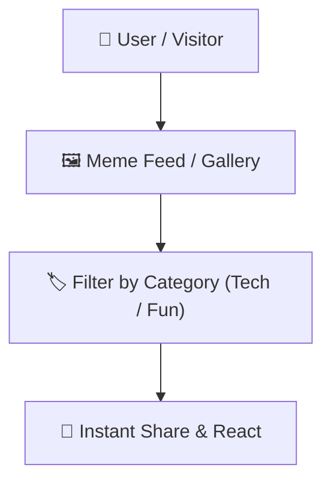

# 🎭 Memes Page — Interactive Humor & Entertainment Hub

  <b>A lightweight, dynamic web application designed to curate, display, and share trending tech and student memes.</b>

---

## 📌 Features

- **Meme Stream**: Dynamic feed of curated tech, programming, and university life memes.
- **Categorization**: Filter memes by tags (Coding, Bugs, Exams, Campus).
- **Responsive Layout**: Mobile-friendly masonry grid display for clean image scaling.

---

## 👨‍💻 Author

**Momin Rifat**  
GitHub: [@MominRifat](https://github.com/MominRifat)
